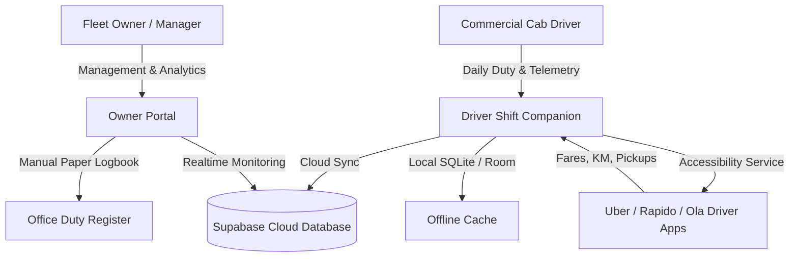

# SVM FLEET — Complete User Manual & Field Operations Guide

> **Version:** 1.0.43  
> **Target Audience:** Fleet Owners, Hub Managers, Commercial Drivers  
> **HQ:** Moosapet Central Hub, Hyderabad  

---

## 📑 Table of Contents
1. [Overview & System Architecture](#1-overview--system-architecture)
2. [Fleet Owner Guide](#2-fleet-owner-guide)
   - [A. Logging into Owner Portal](#a-logging-into-owner-portal)
   - [B. Changing & Managing Your Owner Secret Key](#b-changing--managing-your-owner-secret-key)
   - [C. Onboarding New Drivers (Cloud Sync)](#c-onboarding-new-drivers-cloud-sync)
   - [D. Operating the Office Duty Register](#d-operating-the-office-duty-register)
   - [E. Live Tracking & Vehicle Monitoring](#e-live-tracking--vehicle-monitoring)
3. [Driver Companion Guide](#3-driver-companion-guide)
   - [A. Driver Login & In-App OTP](#a-driver-login--in-app-otp)
   - [B. 3-Step Setup Wizard (Mandatory Permissions)](#b-3-step-setup-wizard-mandatory-permissions)
   - [C. Shift Check-In & Starting Duty](#c-shift-check-in--starting-duty)
   - [D. Active Shift & Automated Ride Ingestion](#d-active-shift--automated-ride-ingestion)
   - [E. Ending Shift & Settlements](#e-ending-shift--settlements)
4. [Live Database Mode vs. 1-Tap Demo Mode](#4-live-database-mode-vs-1-tap-demo-mode)
5. [Troubleshooting & Driver Phone Checklist](#5-troubleshooting--driver-phone-checklist)
6. [Roadmap to Google Play Store](#6-roadmap-to-google-play-store)

---

## 1. Overview & System Architecture

SVM FLEET is a unified dual-interface fleet operating system designed specifically for Hyderabad commercial fleet operators running cabs on **Uber, Rapido, and Ola**:

---

## 2. Fleet Owner Guide

### A. Logging into Owner Portal
1. Open SVM FLEET on your device.
2. Select the **"Fleet Owner"** tab at the top.
3. Enter your 10-digit registered mobile number:
   - Pre-authorized numbers: `+91 93919 15013` (Akhilesh) or `+91 99598 59347` (Office).
   - If using **any other new phone number**, simply type your **Owner Secret Key** (Default: `7777`) into the field labeled *"Owner Secret Key"*. The app will immediately grant Owner Access!
4. Tap **"🛡️ Get SVM FLEET Secure OTP"**.
5. The 4-digit code generates in-app and auto-fills.
6. Tap **"Verify & Access Owner Portal"**.

---

### B. Changing & Managing Your Owner Secret Key
You have full control over your secret access key directly from the app without editing code:
1. In the Owner Portal, tap the **"More"** tab in the bottom navigation.
2. Tap **"Settings"** (or tap your profile card at the top).
3. Under the **"OWNER SECURITY & ACCESS KEY"** card:
   - View your current secret key.
   - Tap **"Owner Secret Key / Master PIN"**.
4. A dialog appears:
   - Enter your **New Secret Key** (e.g. 4 to 6 digits, e.g. `9391`).
   - Confirm the new key.
   - Tap **"Save Key"**.
5. **Done!** From now on, your new secret key can be used from any device to authorize Owner Mode.

---

### C. Onboarding New Drivers (Cloud Sync)
Only drivers registered by the Owner can log into the Driver Companion:
1. Go to **"Cars / Drivers"** tab in the bottom navigation.
2. Tap **"Drivers"** at the top.
3. Tap the purple **"+" (Add Driver)** floating button in the bottom-right corner.
4. Enter the driver details:
   - **Driver Full Name** (e.g. `K. Ramesh`)
   - **Mobile Number** (10-digit phone number, e.g. `9845122710`)
     - *Duplicate Protection:* If this number is already registered, the app instantly shows `⚠️ Mobile already registered for [Driver Name]` and disables the Save button.
   - **Driving License (DL) Number** (e.g. `TS-09-2024-0012345`)
   - **Assign Daily Car** (e.g. `TS09 UB 1840`)
   - **Assign Shift Rotation** (Day 12h, Night 12h, or Full 24h)
5. Tap **"Save Driver"**.
6. The driver is saved to your local database and **synced to Supabase cloud**. The driver can now download the app and log in immediately!

---

### D. Operating the Office Duty Register
To replace the traditional Moosapet paper logbook with digital entries:
1. On the **Home** dashboard, tap the purple **"Open Register"** banner (or access it from **More → Office Duty Register**).
2. Tap **"+ New Register Entry"**.
3. Fill in the shift log:
   - **Cab Reg Number & Driver Name**
   - **Opening Km & Closing Km** (Auto-calculates total running distance)
   - **Daily Gross Earnings** (Combined Uber + Rapido + Ola earnings)
   - **Cash Collected by Driver**
   - **Fuel / CNG Expenditure**
   - **Daily Commission / Cab Rent** (Standard SVM Fleet commission base)
   - **Settlement Method** (Cash vs Online payment)
4. Tap **"Save Duty Log"**.
5. The entry is permanently stored in Supabase with net balance, fuel deduction, and commission ledger.

---

### E. Live Tracking & Vehicle Monitoring
- Under **Cars → Active / Inactive**, inspect each vehicle's live state:
  - 🟢 **Active / On Trip:** Driver is currently logged in, cab meter running.
  - 🟠 **Idle:** Cab is parked at Moosapet hub or waiting for next shift.
  - 🔴 **Inactive / Maintenance:** Vehicle scheduled for servicing or inspection.
- Under **More → Live Tracking**, view battery level, GPS telemetry, and online sync status.

---

## 3. Driver Companion Guide

### A. Driver Login & In-App OTP
1. Driver opens the SVM FLEET app on their Android smartphone.
2. Ensure the **"Driver Shift"** tab is selected.
3. Driver enters their 10-digit registered phone number.
4. If registered by the Owner, the app shows:
   `Verified Driver Partner • Welcome, [Driver Name]! Ready for duty check-in.`
5. Driver taps **"🛡️ Get SVM FLEET Secure OTP"**.
6. The in-app security card shows the 4-digit code and auto-fills it.
7. Tap **"Verify & Start Driver Shift"**.

---

### B. 3-Step Setup Wizard (Mandatory Permissions)
On first launch, the driver must complete the one-time Setup Wizard:

1. **Step 1: Background Battery Optimization (Unrestricted)**
   - Android will otherwise kill the tracking service when the driver turns off the screen.
   - Tap *"Allow Battery Exemption"*, choose *"Unrestricted"*.
2. **Step 2: Accessibility Telemetry Service (`RideTrackerAccessibilityService`)**
   - Allows reading Uber Driver and Rapido Captain fares and trips.
   - Tap *"Enable Accessibility"*, scroll to *Installed Apps / Downloaded Apps*, tap **"SVM Fleet Telemetry"**, and toggle **ON**.
3. **Step 3: Driver Consent (DPDP Act 2023 Compliant)**
   - Review the privacy statement (only work trips and fares are captured during active shift; private messages and browsing are never accessed).
   - Toggle *"I Consent"* and tap *"Finish Setup"*.

---

### C. Shift Check-In & Starting Duty
1. On the **Driver Today** screen:
   - **Driver Name:** Pre-filled with the logged-in driver's verified profile.
   - **Assigned Cab:** Select today's assigned cab from the dropdown (e.g., `TS09 UB 1840 (Hyundai Grand i10)`).
2. Tap the large green button: **"✓ Start Shift & Begin Tracking"**.
3. The tracking status pill turns to **🟢 Active**. Background telemetry is now armed.

---

### D. Active Shift & Automated Ride Ingestion
- The driver can now minimize SVM FLEET and open **Uber Driver** or **Rapido Captain**.
- Whenever the driver accepts, drives, and completes a ride:
  - The accessibility service silently captures the **Platform (Uber/Rapido), Fare (₹), Distance (km), Pickup, and Dropoff**.
  - No manual typing is required!
  - The Driver Companion displays:
    - **Combined Shift Earnings** (e.g. ₹2,840.00)
    - **Total Trips Completed** (e.g. 14 trips)
    - **Platform Split** (Uber ₹1,640 vs Rapido ₹1,200)
    - **Completed Trips List** with time stamps.

---

### E. Ending Shift & Settlements
1. At the end of the shift (e.g. 6:00 PM), the driver reopens SVM FLEET.
2. Tap **"End Shift & Finalize Duty"**.
3. The shift summary is locked and transmitted to the Owner's Office Register.
4. The cab status returns to Idle for the next shift driver.

---

## 4. Live Database Mode vs. 1-Tap Demo Mode

SVM FLEET includes two distinct operating modes:

| Feature | 🔴 Live Production Mode | ⚡ 1-Tap Demo Mode |
|---|---|---|
| **How to Activate** | Normal Login using Phone Number + Secure OTP | Tapping the "⚡ 1-Tap" Demo button on login screen |
| **Data Source** | **100% Live Room & Supabase DB** | Curated Showcase Dataset |
| **New Driver / Zero Rides** | Displays real **₹0.00** and **0 trips** | Displays ₹2,840 (14 sample trips) |
| **Owner Dashboard** | Real sums of active cars, today's real fares | 30 Cars, 28 Active, ₹48,180 Today, ₹5.42L Month |
| **Primary Use** | Daily fleet management, actual cab shifts | Demonstrating the app to clients, investors, drivers |

---

## 5. Troubleshooting & Driver Phone Checklist

### Q1: The driver completed a ride on Uber/Rapido, but it didn't appear in SVM FLEET.
1. **Check Accessibility Service:** Go to Android *Settings → Accessibility → Downloaded Apps → SVM Fleet Telemetry*. Ensure it is **ON**.
2. **Check Shift State:** Ensure the driver tapped **"Start Shift & Begin Tracking"**. Telemetry is ignored when shift is ended to protect driver privacy.
3. **Xiaomi / Realme / Vivo phones (Aggressive Task Killers):**
   - Go to *App Info → Battery Saver → No Restrictions*.
   - Enable *Autostart* in phone settings.

### Q2: How do I test the app without real drivers?
- Use the **"⚡ 1-Tap Owner Demo (Showcase)"** button on the login screen to explore the entire interface with 30 cars and historical data.
- Use the **"⚡ 1-Tap Driver Demo (Anji Babu)"** button to explore driver shift companion.

---

## 6. Roadmap to Google Play Store

When ready to publish to Google Play Store:
1. **Remove `REQUEST_INSTALL_PACKAGES`** from `AndroidManifest.xml` (replaces direct APK updater with Google Play In-App Updates).
2. **Generate Signed Android App Bundle (`.aab`)** using a production `.jks` upload key.
3. **Record Accessibility Disclosure Video (1–2 minutes)** demonstrating how the accessibility service is used exclusively for commercial fleet trip logging.
4. **Publish Privacy Policy URL** detailing data handling under India's Digital Personal Data Protection (DPDP) Act 2023.
5. **Run Closed Testing Track** with 20 testers for 14 continuous days (for personal Google Play Developer accounts).
